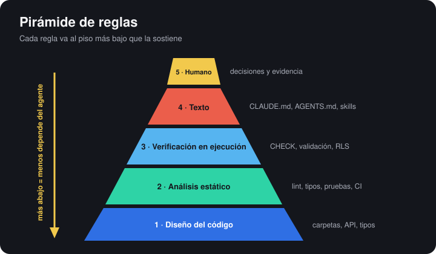

# Pirámide de reglas

Ordena las reglas de un proyecto hecho con agentes en cinco pisos. Cuanto más abajo vive una regla, menos depende de que el agente la lea, la recuerde y la obedezca. La skill tiene dos modos: **planear** (proyecto nuevo o funcionalidad grande) y **auditar** (proyecto en marcha que se quiere reestructurar).

Base: criterio C-003 de `claude-mods/criterios/flujos-claude.md`, con C-001 (error repetido = regla automática) y C-002 (borrar parches y comentarios-excusa).

## Cómo se llama

| Forma | Ejemplo |
| --- | --- |
| Comando en Claude Code | `/cerebro:piramide-reglas planear` o `/cerebro:piramide-reglas auditar` |
| En palabras | «Planea este proyecto con la pirámide de reglas», «audita la pirámide de reglas de este repo» |
| Sugerencia automática | El hook `hooks/sugerir-piramide-reglas.sh` la ofrece al planear un proyecto o al pedir una reestructuración; Angel decide si la usa |

Sin modo indicado: proyecto vacío o recién creado → planear; proyecto con código → auditar.

## Los cinco pisos

| Piso | Qué vive aquí | Cuándo falla la regla | Depende del agente |
| --- | --- | --- | --- |
| 1 · Diseño del código | Estructura de carpetas, API propia, tipos que hacen imposible el caso malo, módulos que esconden lo delicado | Nunca: el error queda sin forma de escribirse | Nada |
| 2 · Análisis estático | Lint con mensajes que dicen el arreglo de fondo, tipos estrictos, compilador, pruebas, CI | Al guardar, al hacer commit o en el pull request | Nada; el agente lee el error y corrige |
| 3 · Verificación en ejecución | Restricciones de la base de datos (`CHECK`, `NOT NULL`, llaves foráneas), validación en los bordes (Zod, Pydantic), aserciones, políticas RLS | Al correr, antes de dañar datos | Poco |
| 4 · Texto | CLAUDE.md, AGENTS.md, skills, reglas del editor | Cuando el agente lo olvida o lo interpreta distinto | Todo |
| 5 · Revisión humana | Decisiones de producto, gusto, riesgos sin vuelta atrás, revisar evidencia (capturas, videos, resultados de pruebas) | Cuando la persona se cansa o revisa a la carrera | Todo, y además la atención de Angel |

Ejemplos de cada piso, por stack: [references/pisos.md](references/pisos.md).

## Árbol para ubicar una regla

Para cada regla, la primera pregunta con respuesta «sí» define su piso:

1. ¿Puedo cambiar la forma del código para que el error no se pueda escribir? (un tipo, una carpeta, una función única que encapsula lo delicado) → piso 1.
2. ¿Una herramienta lo detecta sin ejecutar? (lint, tipo, prueba, chequeo de dependencias) → piso 2.
3. ¿Se comprueba al correr, antes de causar daño? (restricción de base de datos, validación, aserción) → piso 3.
4. ¿Pide juicio, contexto o gusto que una herramienta no mide? → piso 4, en una línea corta de CLAUDE.md.
5. ¿Es una decisión de negocio, de marca o un paso sin vuelta atrás? → piso 5, con aprobación de Angel.

Una regla puede vivir en dos pisos (por ejemplo, tipo en el piso 1 y `CHECK` en el 3). El texto del piso 4 nunca es la única defensa de una regla que una máquina puede comprobar.

## Modo planear

Para un proyecto nuevo o una funcionalidad grande, antes de escribir código.

1. **Listar las reglas.** Con Angel y con el documento de arquitectura, anotar las reglas del proyecto en cuatro grupos: negocio (precios, stock, permisos), arquitectura (qué capa importa a cuál), estilo (convenciones, patrones prohibidos) y seguridad (datos, claves, acciones destructivas).
2. **Ubicar cada regla** con el árbol. Resultado: una tabla `regla | piso | mecanismo | archivo`.
3. **Diseñar el piso 1 primero.** Carpetas que separan capas (por ejemplo `servidor/` y `cliente/`), una función única por operación delicada, tipos de dominio (`Precio`, `Cantidad`) para cada valor con reglas.
4. **Configurar el piso 2 desde el primer commit:** tipos estrictos, lint con reglas propias y mensajes que dicen el arreglo, chequeo de dependencias entre carpetas, pruebas de las reglas de negocio, CI que corre todo en cada pull request, y un hook de Claude Code que corre el lint después de cada edición.
5. **Poner el piso 3 en la base de datos y en los bordes:** cada regla de negocio con su `CHECK` o restricción, y validación de toda entrada externa.
6. **Escribir el piso 4 corto:** CLAUDE.md con lo que pide juicio y con un mapa de dónde vive cada regla (la tabla del paso 2). Cada línea que una máquina puede comprobar sale del texto y baja de piso.
7. **Definir el piso 5:** qué decide Angel, qué acciones piden su aprobación y qué evidencia acompaña cada pull request (capturas, video corto, pruebas en verde).

Entrega: la tabla de pisos, la estructura de carpetas y la lista de configuraciones por crear. Claude crea los archivos con la aprobación de Angel.

Se complementa con la sub-skill `claude-mods/sub-skills/proyecto-produccion-claude-code.md`: sus pasos 1 (arquitectura) y 7 (pruebas en cada pull request) ganan la decisión de en qué piso va cada regla.

## Modo auditar

Para un proyecto en marcha, cuando el agente repite errores, el CLAUDE.md creció mucho o Angel quiere reestructurar.

1. **Inventario de reglas escritas:** leer CLAUDE.md, AGENTS.md, `.cursor/rules`, `.claude/`, skills del proyecto y comentarios con «IMPORTANTE», «NUNCA», «SIEMPRE» o «no tocar».
2. **Inventario de errores repetidos:** revisar el historial (`git log` con «fix», «arregla», «revert»), los comentarios de pull requests y los parches copiados en varios archivos (C-002).
3. **Inventario de defensas existentes:** configuración de tipos y de lint, reglas propias, pruebas, CI, restricciones de la base de datos, validaciones y hooks.
4. **Clasificar.** Tabla `regla | piso actual | piso posible | mecanismo | esfuerzo (bajo, medio, alto)`. Marcar en rojo cada regla que vive solo en texto y una máquina puede comprobar.
5. **Priorizar:** primero las reglas de dinero, datos y seguridad que viven solo en texto; luego los errores repetidos; luego el estilo.
6. **Proponer el plan** a Angel con el informe y una vista de la pirámide antes y después (cuántas reglas hay en cada piso). Cada cambio se aplica con su aprobación, en pull requests pequeños: un mecanismo por pull request, con su prueba.
7. **Adelgazar el texto:** cada regla que bajó de piso sale de CLAUDE.md; en su lugar queda, si hace falta, una línea que dice dónde vive ahora.

Entrega: informe con la tabla, el conteo por piso antes y después y los pull requests propuestos en orden.

## Señales de alerta

- CLAUDE.md o AGENTS.md con más de cien líneas, o con palabras en mayúsculas para insistir.
- La misma corrección pedida dos veces por chat.
- Reglas de dinero, stock o permisos que solo existen en el texto o en el código de la interfaz.
- Lint con la configuración de serie y cero reglas propias.
- Comentarios que justifican un parche y dejan viva la causa.

## Verificación

- Cada regla del proyecto aparece en la tabla con su piso y su mecanismo.
- Ninguna regla de negocio comprobable vive solo en el texto.
- Cada regla del piso 2 tiene un mensaje de error que dice el arreglo de fondo.
- CI corre los pisos 2 y 3 en cada pull request.
- CLAUDE.md queda corto: lo que pide juicio y el mapa de dónde vive cada regla.

## Fuente

- Criterio C-003, desde el [reel de @jamessotovalle en Instagram](https://www.instagram.com/reel/DgGZ0AIiY6I/) sobre el modelo de Lauren Tan, «All Code Is Slop (Except Mine)», AI Engineer CODE Summit 2026. Detalle en [fuentes.md](fuentes.md).
